# PharmaTrack MES & eBR — Pharmaceutical Manufacturing Execution & Electronic Batch Record System

[](https://openjdk.org/)
[](https://spring.io/projects/spring-boot)
[](https://react.dev/)
[](https://vitejs.dev/)
[](https://tailwindcss.com/)
[](https://tidbcloud.com/)
[](https://flywaydb.org/)
[](https://www.docker.com/)
[](https://github.com/nimishaWargantiwar/Pharma-Track)

> **Educational & Engineering Portfolio Showcase:** A full-stack web application demonstrating core concepts of a pharmaceutical Manufacturing Execution System (MES) and Electronic Batch Record (eBR). Features role-based sequential batch execution, multi-parameter quality release gates, a 5-stage deviation and CAPA lifecycle, raw material lot tracking, and QR-based batch dossier lookups.

---

## 🌐 Live Production Deployments & Service Links

| Service Component | Target Platform | Live Public URL | Active Health Probe |
| :--- | :--- | :--- | :--- |
| **Production Web Application** | Cloudflare Pages | [pharma-track.pages.dev](https://pharma-track.pages.dev) | Static SPA Delivery (`HTTP 200 OK`) |
| **Production REST API Engine** | Render Web Service (Docker) | [pharmatrack-backend-92pf.onrender.com](https://pharmatrack-backend-92pf.onrender.com) | Spring Boot Application Engine |
| **Database Connectivity Probe** | Render Public API | [/api/health](https://pharmatrack-backend-92pf.onrender.com/api/health) | Dynamic Database Check (`HTTP 200 OK`) |
| **Distributed Relational Database** | TiDB Cloud Starter (AWS Tokyo) | `gateway01.ap-northeast-1.prod.aws.tidbcloud.com` | 18 Relational Application Tables + Flyway History |
| **Source Code Repository** | GitHub | [github.com/nimishaWargantiwar/Pharma-Track](https://github.com/nimishaWargantiwar/Pharma-Track) | Full-Stack Monorepo |

> [!NOTE]
> **Deployment Architecture & Free-Tier Operational Behavior:**
> - **Frontend Delivery:** Cloudflare Pages hosts the compiled React 18 SPA (`dist/`) over global edge CDN with zero cold-start delay.
> - **Backend Availability:** Render Free Web Service hosts the containerized Spring Boot 3.3.5 JAR. Free instances spin down after 15 minutes of inactivity. When asleep, initial HTTP requests may experience a 30–50 second cold-start delay while the container boots.
> - **Session Cold-Start Resilience:** `AuthContext.jsx` includes a built-in retry mechanism that preserves the operator's JWT in `sessionStorage` during backend wakeups without prematurely invalidating authentication.
> - **Health Verification vs. Feature Verification:** An `HTTP 200 OK` response from `GET /api/health` verifies that the Spring application context has initialized and that HikariCP has successfully validated database connectivity against TiDB Cloud (`SELECT 1`). End-to-end operational features (step transitions, electronic batch records, QA gates) are defended separately by 808 automated tests.

---

> [!IMPORTANT]
> **Demonstration & Regulatory Disclaimer:**
> **PharmaTrack MES & eBR** is an educational engineering showcase and portfolio project modeled after pharmaceutical manufacturing execution (MES), electronic batch record (eBR), quality control, QA disposition, and deviation/CAPA workflows.
>
> **It is NOT certified, validated, or approved for real GxP / cGMP manufacturing, GAMP 5 computer system validation, or FDA 21 CFR Part 11 / EU Annex 11 commercial production use.** Do not deploy or rely on this software for clinical, commercial, or regulated drug manufacturing operations without independent regulatory qualification, validated infrastructure, hardware/infrastructure clock controls, cryptographic PKI/re-authentication electronic signature controls, and formal IQ/OQ/PQ validation documentation.

---

## 📑 Table of Contents

1. [Executive Summary & Problem Statement](#1-executive-summary--problem-statement)
2. [Project Objectives & Core Engineering Principles](#2-project-objectives--core-engineering-principles)
3. [Key Platform Capabilities](#3-key-platform-capabilities)
4. [Visual Module Walkthrough & Deep-Dive](#4-visual-module-walkthrough--deep-dive)
   - [4.1 Login & Application Access](#41-login--application-access)
   - [4.2 Product Master Catalog](#42-product-master-catalog)
   - [4.3 Master Recipe Management & Versioning](#43-master-recipe-management--versioning)
   - [4.4 Manufacturing Orders & Scheduling](#44-manufacturing-orders--scheduling)
   - [4.5 Production Execution Queue](#45-production-execution-queue)
   - [4.6 Electronic Batch Records (eBR)](#46-electronic-batch-records-ebr)
   - [4.7 Quality Management & In-Process Controls](#47-quality-management--in-process-controls)
   - [4.8 Deviations & CAPA Incident Management](#48-deviations--capa-incident-management)
   - [4.9 Centralized System Audit Trail](#49-centralized-system-audit-trail)
   - [4.10 Raw Material Inventory & Warehouse Management](#410-raw-material-inventory--warehouse-management)
   - [4.11 QR Batch Traceability & Digital Dossier](#411-qr-batch-traceability--digital-dossier)
   - [4.12 User Administration & Role Governance](#412-user-administration--role-governance)
5. [Role-Based Access Control (RBAC) Matrix](#5-role-based-access-control-rbac-matrix)
6. [System Architecture & Infrastructure](#6-system-architecture--infrastructure)
7. [Frontend Architecture & Implementation](#7-frontend-architecture--implementation)
8. [Backend Architecture & Implementation](#8-backend-architecture--implementation)
9. [Database Design & Flyway Evolution](#9-database-design--flyway-evolution)
10. [Comprehensive REST API Reference](#10-comprehensive-rest-api-reference)
11. [Complete Business Workflows](#11-complete-business-workflows)
    - [11.1 End-to-End Manufacturing Lifecycle](#111-end-to-end-manufacturing-lifecycle)
    - [11.2 Raw Material Inventory & Issue Lifecycle](#112-raw-material-inventory--issue-lifecycle)
    - [11.3 Quality Testing, Deviation & CAPA Lifecycle](#113-quality-testing-deviation--capa-lifecycle)
12. [Security Architecture & Implementation](#12-security-architecture--implementation)
13. [Validation & Error Handling Strategy](#13-validation--error-handling-strategy)
14. [Testing Strategy & Quality Assurance](#14-testing-strategy--quality-assurance)
15. [Technical Decisions & Architectural Trade-offs](#15-technical-decisions--architectural-trade-offs)
16. [Technology Stack Reference](#16-technology-stack-reference)
17. [Local Development & Setup Guide](#17-local-development--setup-guide)
18. [Production Deployment Guide](#18-production-deployment-guide)
19. [Future Roadmap](#19-future-roadmap)
20. [Known Limitations](#20-known-limitations)
21. [Project Showcase & Contact](#21-project-showcase--contact)

---

## 1. Executive Summary & Problem Statement

### The Pharmaceutical Manufacturing Reality
In pharmaceutical manufacturing, process integrity is directly tied to patient safety. Unlike discrete manufacturing (such as electronics or automotive assembly), pharmaceutical manufacturing produces chemical and biological therapeutics where microscopic variations in formulation, temperature, mixing duration, or raw material purity can result in ineffective or toxic drug products.

Consequently, global regulatory authorities (FDA, EMA, WHO, PMDA) mandate strict adherence to **Current Good Manufacturing Practice (cGMP)**. Historically, cGMP compliance relied on physical **Paper Batch Records (BBRs)**—large binders containing hundreds of pages of printed standard operating procedures (SOPs), manual sign-off tables, instrument chart recorder printouts, and physical weight slips.

### Operational Liabilities of Paper-Based Batch Manufacturing
1. **Transcription Errors & Illegibility:** Hand-written operator initials, temperature logs, and balance readings introduce transcription mistakes, calculation errors, and legibility risks during regulatory inspections.
2. **Sequential Enforcement Gaps:** Paper records cannot physically prevent an operator from skipping critical antecedent steps (e.g., granulating active ingredients before checking blender sanitation).
3. **Delayed Batch Release (Binder Review Lag):** QA teams must manually inspect thousands of physical binder pages, verify every signature, cross-check calibration logs, and review deviation attachments before a batch can be released for commercial distribution. This creates a release bottleneck that can delay drug distribution by 2–4 weeks.
4. **Siloed Material Traceability:** Investigating which finished commercial packages contain an expired excipient lot requires manually cross-referencing warehouse logbooks, dispensary weight sheets, and production binders.
5. **Disconnected Deviation & CAPA Cycles:** Unplanned shop-floor excursions documented on paper incident sheets often fail to halt batch release, creating critical regulatory non-compliance risks.

### The PharmaTrack MES & eBR Solution
PharmaTrack demonstrates these pharmaceutical manufacturing concepts through a structured full-stack web application:
- **Enforced Step Sequences:** Shop-floor execution steps require sequential advancement; step `N` cannot be completed until step `N-1` is completed with validated operational parameters.
- **Automated Yield & In-Process Evaluations:** Yield recovery percentages and QC specification tolerance rules are evaluated automatically in the service layer.
- **QA Disposition Release Gate:** The application blocks QA disposition to `APPROVED` if mandatory QC checks are missing, test results fail specifications, or open deviations remain unclosed.
- **Traceable Material Links:** Connects raw material lots to warehouse storage locations, dispensary material issues, manufacturing orders, and finished batch QR identifiers.
- **Server-Derived Actor Attribution:** Captures authenticated usernames and server timestamps (`Asia/Kolkata` / `+05:30`) with UTC persistence in the database.

---

## 2. Project Objectives & Core Engineering Principles

PharmaTrack was designed around six core full-stack software engineering principles:

1. **Modular Decoupling:** Complete separation of presentation (React 18 SPA) and business/persistence layers (Spring Boot 3 + TiDB Cloud). The frontend communicates exclusively via authenticated RESTful JSON APIs.
2. **Server-Derived Attribution & Sanitized Error Responses:** Identity is extracted directly from verified JWT claims (`AuthenticatedActorResolver`), and timestamps are assigned by the server (`AppTime`). `GlobalExceptionHandler` formats errors to prevent database connection strings or stack traces from leaking to clients.
3. **Fail-Closed Production Configuration:** In the `prod` profile, `ProductionConfigurationGuardInitializer` prevents application startup if required settings (minimum 256-bit `JWT_SECRET`, non-wildcard `CORS_ALLOWED_ORIGINS`, database credentials, or TLS configuration) are missing or set to local defaults.
4. **Role Separation (RBAC):** System administrators manage users and products but cannot execute steps or log deviations; operators execute batch steps; QC analysts record analytical checks; QA reviewers control batch release and deviation closure.
5. **Relational Schema Migrations:** All 18 application tables are managed using Flyway migrations (`V1`, `V2`, `V3`), preserving foreign keys, check constraints, and unique indexes across releases.
6. **Automated Test Coverage:** 808 automated tests (684 backend across 57 test suites + 124 frontend unit/integration tests) verify controller endpoints, service logic, authorization guards, and state transitions.

---

## 3. Key Platform Capabilities

| Capability Domain | Operational Description | Implementation Highlights |
| :--- | :--- | :--- |
| **5-Tier Role Governance** | Complete separation of duties across 5 distinct operational life-sciences roles. | Enforced via Spring Security `SecurityFilterChain`, `@PreAuthorize`, and React route guards. |
| **Electronic Batch Records** | Shop-floor execution ledger tracking equipment IDs, process parameters, and yield reconciliations. | Sequential state machine (`PENDING` ➔ `IN_PROGRESS` ➔ `COMPLETED` / `SKIPPED`). |
| **In-Process Controls (IPC)** | Automated evaluation of recorded analytical values against recipe-defined tolerance limits. | Lower/upper specification validation, audited test corrections with mandatory justifications. |
| **5-Stage Deviation & CAPA** | Full incident investigation lifecycle with 5 Whys analysis, root cause categorization, and CAPA tasks. | Controlled state transitions (`OPEN` ➔ `UNDER_INVESTIGATION` ➔ `CAPA_IN_PROGRESS` ➔ `PENDING_VERIFICATION` ➔ `CLOSED`). |
| **Lot-Level Inventory** | Multi-facility warehouse zoning, raw material receipt, expiry tracking, and order BOM issuing. | Append-only `stock_movements` ledger with quantity before/after balances. |
| **QR Batch Traceability** | Dynamic generation of deterministic batch QR identifiers and instant digital dossier retrieval. | Hardware-independent browser `BarcodeDetector` scanning with camera fallback. |
| **Centralized Audit Trail** | Application-level logging of administrative, operational, and quality mutations. | Append-only `audit_logs` table capturing entity type, action, actor username, and before/after JSON states. |

---

## 4. Visual Module Walkthrough & Deep-Dive

All 11 screenshots below are genuine captures from the live production deployment at [https://pharma-track.pages.dev](https://pharma-track.pages.dev).

---

### 4.1 Login & Application Access

The authentication portal serves as the single point of entry, featuring role-based demo presets, strict credential validation, and session restoration handling.

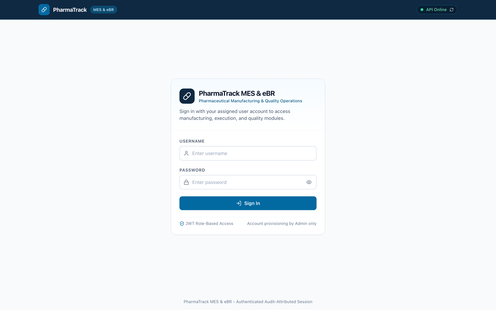

*Figure 1: Authentication portal showing active session status, demo credential buttons, and responsive login card.*

- **Module Purpose:** Establish authenticated identity, deliver signed JWT credentials, and initialize user session state across browser tabs.
- **Industry Concept:** In regulated facilities, access control is the first line of defense against unauthorized batch record alteration.
- **Features & Operations:** User credential submission, demo role quick-selection, error alert presentation, and session restoration.
- **Inputs & Outputs:** Accepts username and password strings. Emits a signed HS256 JWT access token along with user profile metadata (`username`, `fullName`, `role`).
- **Business Rules & Validations:** Form blocks submission on empty fields; backend validates credentials against BCrypt hashes; disabled accounts are rejected with `401 Unauthorized`.
- **Role Permissions:** Publicly reachable endpoint (`POST /api/auth/login`).
- **Frontend Implementation:** `LoginPage.jsx` manages local form state; `AuthContext.jsx` stores the JWT in browser `sessionStorage` (preventing cross-tab token contamination) and attaches it to outbound API requests.
- **Backend Implementation:** `AuthController.java` delegates to Spring Security `AuthenticationManager`, which invokes `CustomUserDetailsService` to verify BCrypt hashes and generate tokens via `JwtService`.
- **Database Relationships:** Reads from `user_accounts` table.
- **Integration:** Initial authentication determines active permissions across all subsequent modules.

---

### 4.2 Product Master Catalog

The central catalog of active pharmaceutical formulations, dosage forms, therapeutic categories, and commercial serialization parameters.

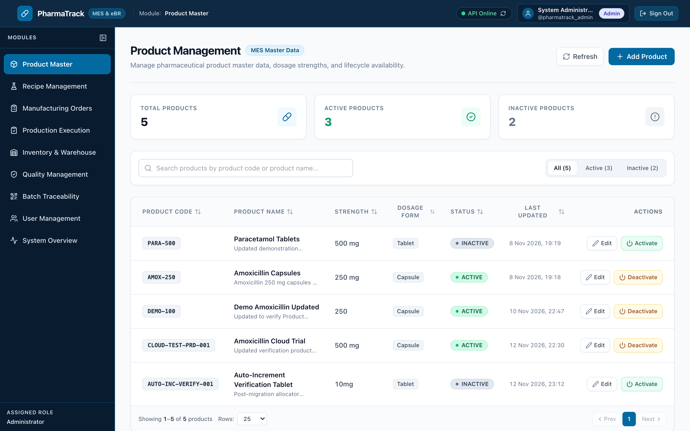

*Figure 2: Product Master catalog displaying active formulations, therapeutic categories, dosage forms, and status toggles.*

- **Module Purpose:** Maintain the master list of approved drug formulations configured in the system.
- **Industry Concept:** Product master data defines the approved regulatory filing (NDA/ANDA) specification for finished pharmaceuticals.
- **Features & Operations:** Product listing with search/filter, formulation registration, metadata editing, and active status toggling.
- **Inputs & Outputs:** Inputs: Product Code (e.g., `PRD-PARA-500`), Generic Name, Brand Name, Dosage Form (Tablet, Capsule, Liquid, Injection), Strength, Shelf Life (Months), Storage Conditions. Outputs: Structured product list and individual product detail DTOs.
- **Business Rules & Validations:** Product Code must be unique; shelf life must be positive; inactive products cannot be used to author new recipes or schedule new manufacturing orders.
- **Role Permissions:** `ADMIN` has full author and edit rights; `PRODUCTION_SUPERVISOR`, `OPERATOR`, `QC_ANALYST`, and `QA_REVIEWER` have read-only viewing permissions.
- **Frontend Implementation:** `ProductManagement.jsx` renders `ProductTable.jsx` and `ProductModal.jsx` using `productApi.js`.
- **Backend Implementation:** `ProductController.java` (`/api/products`) invokes `ProductService.java` which enforces unique constraints via `ProductRepository.java`.
- **Database Relationships:** Primary entity in `products` table; referenced by `recipes` (`recipes.product_id`) and `manufacturing_orders` (`orders.product_id`).

---

### 4.3 Master Recipe Management & Versioning

Master Recipes govern the manufacturing procedure, defining ordered execution stages, operational parameters, and in-process quality control specifications.

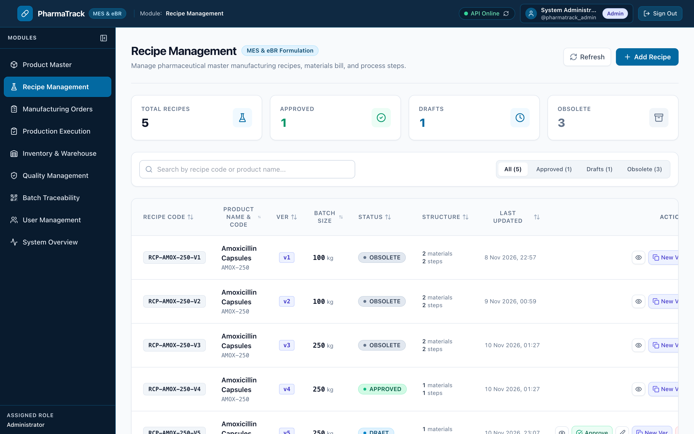

*Figure 3: Master Recipe Management with versioning controls, step sequences, and QC specifications.*

- **Module Purpose:** Define standard manufacturing instructions, required equipment, operational parameter ranges, and quality specifications.
- **Industry Concept:** In pharmaceutical manufacturing, production runs follow an approved Master Batch Record (MBR) recipe. In this application, approved recipes cannot be directly edited; modifications require creating a new incremented version.
- **Features & Operations:** Recipe authoring, step sequencing, QC specification mapping, version incrementing (`new-version`), and status lifecycle (`DRAFT` ➔ `APPROVED` ➔ `ARCHIVED`).
- **Inputs & Outputs:** Inputs: Associated Product ID, Recipe Code, Version, Description, Recipe Steps (Step Number, Name, Instructions, Equipment Type, Duration Minutes, Target Temperature), and QC Specs (Test Name, Min Limit, Max Limit, Unit, Mandatory flag). Outputs: Full recipe definition.
- **Business Rules & Validations:** Step numbers must be positive and non-colliding; approved recipes are locked against in-place edits (modifications require creating a new incremented version); only approved recipes can be scheduled into manufacturing orders.
- **Role Permissions:** `ADMIN` and `PRODUCTION_SUPERVISOR` can author recipes; `QA_REVIEWER` has view and status lifecycle approval (`APPROVED`, `ARCHIVED`); `QC_ANALYST` has view only; `OPERATOR` is strictly blocked and excluded.
- **Frontend Implementation:** `RecipeManagement.jsx`, `RecipeTable.jsx`, and `RecipeModal.jsx` consuming `recipeApi.js`.
- **Backend Implementation:** `RecipeController.java` (`/api/recipes`) delegates to `RecipeService.java`.
- **Database Relationships:** `recipes` table connects to `products` (`fk_recipes_product`), `recipe_steps` (`recipe_id`), and `qc_specifications` (`recipe_id`).

---

### 4.4 Manufacturing Orders & Scheduling

Bridges production planning with shop-floor execution by scheduling orders against approved master recipes and generating discrete production batches.

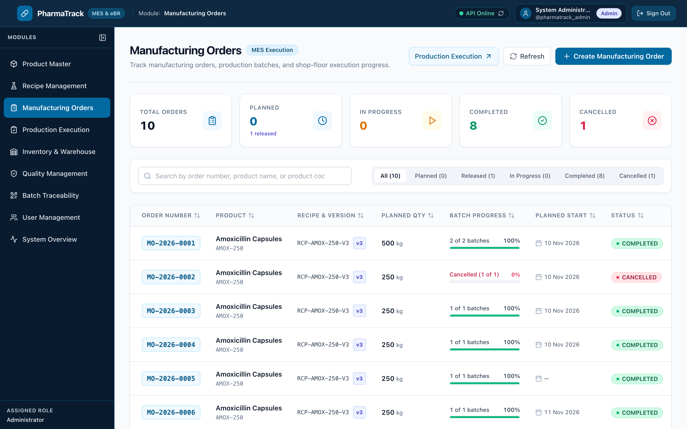

*Figure 4: Manufacturing Order queue with batch release controls and BOM inventory status.*

- **Module Purpose:** Schedule commercial production quantities, assign target delivery dates, and provision unique production batches.
- **Industry Concept:** Manufacturing Orders represent the operational authorization to convert raw materials into finished pharmaceutical lots.
- **Features & Operations:** Order creation, status lifecycle management (`PLANNED`, `RELEASED`, `IN_PROGRESS`, `COMPLETED`, `CANCELLED`), batch provisioning, and Bill of Materials (BOM) inventory checking.
- **Inputs & Outputs:** Inputs: Order Number, Target Product ID, Target Recipe ID, Planned Quantity, Unit, Start Date, Target Completion Date. Outputs: Provisioned Order entity and child Batch records.
- **Business Rules & Validations:** Releasing an order automatically creates associated production batch records with pre-assigned lot numbers; orders cannot be released if the target recipe is not in `APPROVED` status; cancelled orders cascade cancellation to unstarted batches.
- **Role Permissions:** `ADMIN` and `PRODUCTION_SUPERVISOR` can create, release, and cancel orders; all other roles have read-only visibility.
- **Frontend Implementation:** `OrderManagement.jsx`, `OrderTable.jsx`, and `OrderModal.jsx` using `orderApi.js`.
- **Backend Implementation:** `ManufacturingOrderController.java` (`/api/orders`) delegates to `ManufacturingOrderService.java` using `@Transactional` batch provisioning.
- **Database Relationships:** `manufacturing_orders` connects to `products`, `recipes`, and `batches` (`batches.order_id`).

---

### 4.5 Production Execution Queue

The central dashboard for shop floor supervisors and operators, tracking live status, progress percentages, and active processing stages across all plant batches.


*Figure 5: Production Execution dashboard displaying batch statuses, target quantities, and execution steps.*

- **Module Purpose:** Provide shop-floor visibility into all manufacturing batches awaiting or undergoing execution.
- **Industry Concept:** Production scheduling requires clear demarcation between planned work, active processing, and finalized lots.
- **Features & Operations:** Batch filtering by status (`PLANNED`, `IN_PROGRESS`, `COMPLETED`, `CANCELLED`), progress tracking, and one-click workspace launch.
- **Inputs & Outputs:** Inputs: Search query, status filter. Outputs: Batch queue items with calculated execution step progress.
- **Business Rules & Validations:** Batches must be initialized before steps can be completed; batches in `COMPLETED` or `CANCELLED` states are permanently locked against execution modifications.
- **Role Permissions:** All authenticated roles can view the execution queue.
- **Frontend Implementation:** `ProductionExecution.jsx` renders `ExecutionBatchTable.jsx` and launches `ExecutionWorkspace.jsx`.
- **Backend Implementation:** `ProductionExecutionController.java` (`GET /api/batches/execution`) delegates to `ProductionExecutionService.java`.
- **Database Relationships:** Queries `batches`, `manufacturing_orders`, and `batch_execution_steps`.

---

### 4.6 Electronic Batch Records (eBR)

The core shop-floor interface where licensed operators execute production steps in strict sequence, capture real-time equipment readings, and record actual yields.

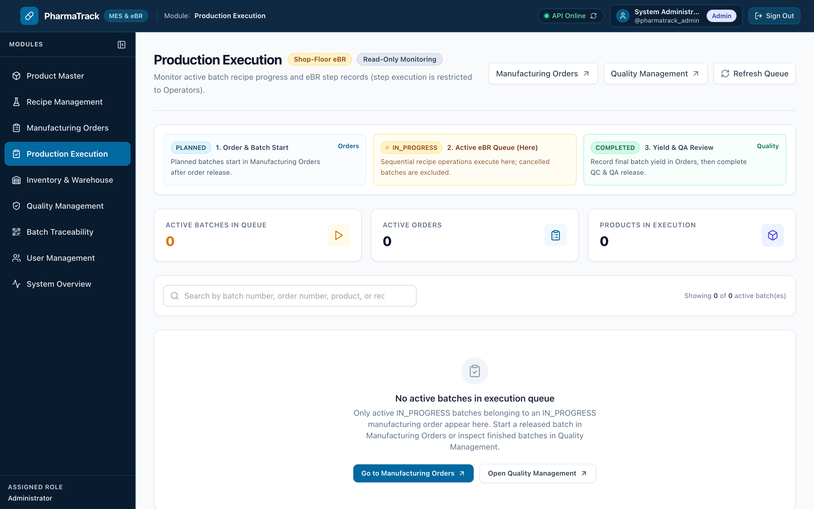

*Figure 6: Electronic Batch Record workspace enforcing ordered step completion, parameter capture, and yield logging.*

- **Module Purpose:** Digital execution of MBR steps, capturing operational parameters, operator initials, and yield reconciliations.
- **Industry Concept:** The eBR is the definitive legal record of drug manufacturing, establishing that every step conformed to approved SOPs.
- **Features & Operations:** Step initialization from recipe template, sequential step advancement (`start` ➔ `complete`), equipment ID capture, parameter logging, and final yield reconciliation.
- **Inputs & Outputs:** Inputs: Equipment ID, observed temperature/speed, operator notes, actual packaged yield quantity. Outputs: Step execution audit record and batch yield recovery percentage.
- **Business Rules & Validations:** Enforces strict sequential order (step `N` cannot start until step `N-1` is complete); yield reconciliation compares actual yield against theoretical target and computes recovery percentage.
- **Role Permissions:** Execution step transitions (`start`, `complete`, `initialize`) are strictly restricted to `OPERATOR`; `ADMIN` and `PRODUCTION_SUPERVISOR` can record final yield; all roles have read-only review rights.
- **Frontend Implementation:** `ExecutionWorkspace.jsx` and `CompleteExecutionStepModal.jsx` utilizing `productionExecutionApi.js`.
- **Backend Implementation:** `ProductionExecutionController.java` delegates to `ProductionExecutionService.java`, enforcing pessimistic locking on batch transitions.
- **Database Relationships:** `batch_execution_steps` linked to `batches` (`batch_id`) and `recipe_steps` (`recipe_step_id`).

---

### 4.7 Quality Management & In-Process Controls

Provides comprehensive analytical testing across physical, chemical, and microbiological parameters, backed by a formal QA disposition gate.

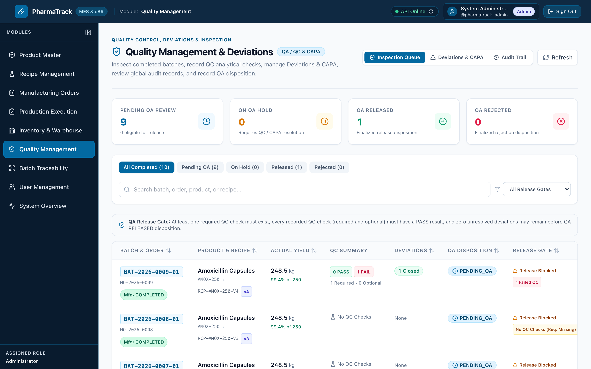

*Figure 7: In-process quality control tests and formal QA release evaluation gate.*

- **Module Purpose:** Execute analytical quality checks against batches and enforce formal QA release dispositions.
- **Industry Concept:** In-process testing ensures critical quality attributes (CQAs) remain within acceptable tolerances before drug release.
- **Features & Operations:** QC test recording, automated out-of-specification (OOS) evaluation, audited test corrections, and QA disposition decision (`APPROVED`, `REJECTED`, `HOLD`).
- **Inputs & Outputs:** Inputs: Test Name, Measured Numeric Value, Observations, Test Unit. Outputs: `PASS` / `FAIL` determination and final QA batch disposition.
- **Business Rules & Validations:**
  - Recorded values are mathematically evaluated against specification `min_limit` and `max_limit`.
  - **QA Release Gate:** Releasing a batch to `APPROVED` requires:
    1. Batch status must be `COMPLETED`.
    2. All mandatory QC checks must be present and marked `PASS`.
    3. Zero unresolved deviations may exist against the batch.
- **Role Permissions:** `QC_ANALYST` records and corrects checks; `QA_REVIEWER` performs batch disposition; other roles have read-only visibility.
- **Frontend Implementation:** `QualityManagement.jsx`, `QualityBatchTable.jsx`, `QualityCheckModal.jsx`, and `QaDispositionModal.jsx`.
- **Backend Implementation:** `QualityController.java` (`/api/quality`) delegates to `QualityService.java`.
- **Database Relationships:** `quality_checks` table linked to `batches` (`batch_id`) and `qc_specifications`.

---

### 4.8 Deviations & CAPA Incident Management

A structured 5-stage deviation workflow modeled on pharmaceutical quality procedures, documenting unplanned events, containment actions, root causes, and corrective/preventive actions.

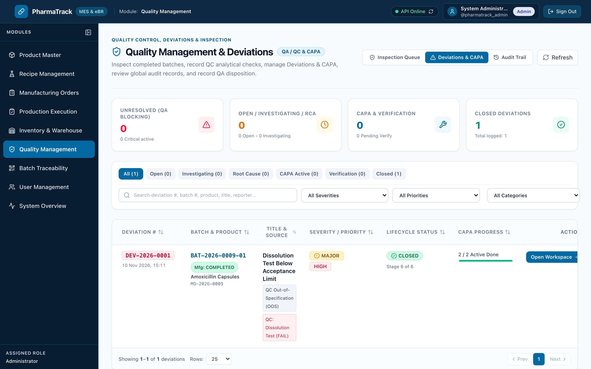

*Figure 8: Deviation investigation workspace with 5-stage lifecycle and CAPA task tracking.*

- **Module Purpose:** Capture unplanned manufacturing excursions, perform root cause investigations, execute corrective/preventive tasks, and verify closure.
- **Industry Concept:** Regulated manufacturing mandates thorough investigation of any deviation from approved procedures or specifications.
- **Features & Operations:** Incident logging, severity rating (Minor, Major, Critical), 5 Whys root cause analysis, CAPA task assignment, effectiveness verification, and formal QA closure.
- **Inputs & Outputs:** Inputs: Deviation Title, Description, Severity, Category (Equipment, Material, Human, Procedure), 5 Whys Analysis, CAPA Action Items with due dates. Outputs: Audited deviation lifecycle state and linked CAPA records.
- **Business Rules & Validations:**
  - `OPEN` deviations immediately flag the batch and lock it against QA release.
  - Advancing from `CAPA_IN_PROGRESS` to `PENDING_VERIFICATION` requires all linked CAPA tasks to be completed.
  - Closing a deviation permanently locks it against further modification.
- **Role Permissions:**
  - Incident Logging: `PRODUCTION_SUPERVISOR`, `OPERATOR`, `QC_ANALYST`, `QA_REVIEWER` (`ADMIN` blocked).
  - Investigation & RCA: `PRODUCTION_SUPERVISOR`, `QC_ANALYST`, `QA_REVIEWER`.
  - CAPA Execution: `PRODUCTION_SUPERVISOR`, `QC_ANALYST`, `QA_REVIEWER`.
  - Formal Transitions (`start-capa`, `reopen-capa`, `cancel`, `close`): Exclusively `QA_REVIEWER`.
- **Frontend Implementation:** `DeviationManagement.jsx`, `DeviationWorkspace.jsx`, `ReportDeviationModal.jsx`, and `CapaTaskModal.jsx` using `deviationApi.js`.
- **Backend Implementation:** `DeviationController.java` (`/api/quality/deviations`, `/api/quality/capas`) delegates to `DeviationService.java`.
- **Database Relationships:** `deviations` linked to `batches`; `capa_tasks` linked to `deviations`.

---

### 4.9 Centralized System Audit Trail

Provides a chronological log of administrative, production, quality, and inventory mutations recorded in the `audit_logs` table.

- **Module Purpose:** Maintain operational traceability by recording what action occurred, the authenticated username responsible, server timestamp, and state deltas.
- **Industry Concept:** Regulated manufacturing emphasizes data integrity (accurate attribution and contemporaneous records). In this application, audit rows capture the actor's username, timestamp, and JSON before/after snapshots upon entity mutations.
- **Features & Operations:** System-wide audit log query, entity-scoped audit history, and before/after value inspection.
- **Inputs & Outputs:** Inputs: Entity type, date range, actor filter. Outputs: JSON records showing `entity_type`, `action`, `actor_name`, `occurred_at`, `before_values`, `after_values`, and `reason`.
- **Business Rules & Validations:** Audit logs are append-only; entries can never be updated or deleted via API endpoints.
- **Role Permissions:** Viewing audit logs is restricted to `ADMIN` and `QA_REVIEWER`.
- **Frontend Implementation:** `AuditLogModal.jsx` and embedded history views in `QualityManagement.jsx`.
- **Backend Implementation:** `QualityController.java` (`GET /api/quality/audit-logs`) and `AuthenticatedActorResolver.java`.
- **Database Relationships:** `audit_logs` table linked optionally to `batches` (`batch_id`).

---

### 4.10 Raw Material Inventory & Warehouse Management

Introduced in Flyway Migration `V2`, this module provides full inventory governance across raw ingredients, storage facilities, and traceable lots.

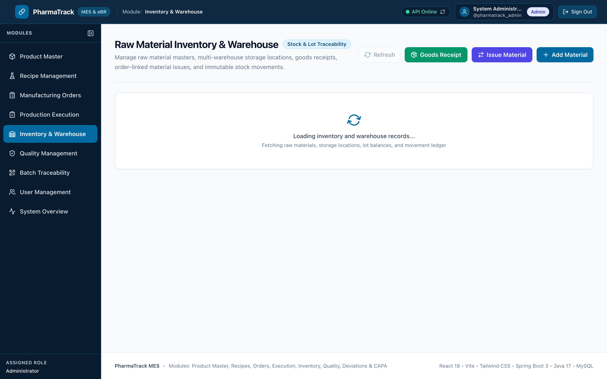

*Figure 9: Raw material warehouse inventory, storage locations, and active material lots.*

- **Module Purpose:** Manage raw materials, warehouse zoning (Aisle, Rack, Bin), material lot receiving, and stock movements.
- **Industry Concept:** In pharmaceutical operations, raw materials must be strictly controlled, quarantined upon receipt, and verified for expiry before dispensary issue.
- **Features & Operations:** Raw material master registration, warehouse and storage location creation, goods receipt (`GOODS_RECEIPT`), material issuance to orders (`MATERIAL_ISSUE`), and audited stock adjustments (`STOCK_ADJUSTMENT`).
- **Inputs & Outputs:** Inputs: Material Code, Lot Number, Expiry Date, Storage Location ID, Quantity, Supplier Name. Outputs: Active lot inventory balance and movement history.
- **Business Rules & Validations:**
  - Material lots in `EXPIRED` or `QUARANTINED` status cannot be issued to manufacturing orders.
  - Material issues decrement available lot stock and verify against order BOM requirements.
  - Stock movements are recorded in an append-only ledger (`stock_movements` table) via goods receipt, issue, and adjustment APIs (no update or delete endpoints are exposed).
- **Role Permissions:** `ADMIN` and `PRODUCTION_SUPERVISOR` manage receipts, materials, and locations; `OPERATOR` can perform material issues; `QA_REVIEWER` can perform adjustments; `QC_ANALYST` has view only.
- **Frontend Implementation:** `InventoryManagement.jsx`, `GoodsReceiptModal.jsx`, `MaterialIssueModal.jsx`, and `StockAdjustmentModal.jsx`.
- **Backend Implementation:** `InventoryController.java` (`/api/inventory`) delegates to `InventoryService.java`.
- **Database Relationships:** `raw_materials`, `warehouses`, `storage_locations`, `material_lots`, and `stock_movements`.

---

### 4.11 QR Batch Traceability & Digital Dossier

Introduced in Flyway Migration `V3`, this module delivers instantaneous batch lookup via camera QR scanning or manual identifier search.

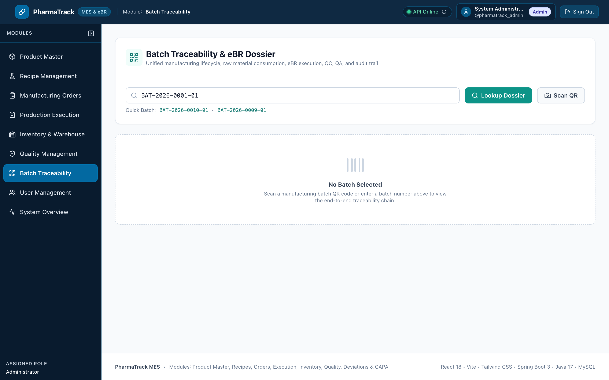

*Figure 10: QR-driven batch dossier lookup with camera barcode scanner and full batch history.*

- **Module Purpose:** Provide instant, single-scan traceability from a physical batch QR label to the entire digital manufacturing record.
- **Industry Concept:** Track-and-trace serialization allows rapid product recall, verification of authenticity, and transparent regulatory inspection.
- **Features & Operations:** Camera-based live barcode scanning, manual QR string lookup, printable QR code generation, and 8-section complete digital dossier display.
- **Inputs & Outputs:** Inputs: Camera video feed or text query (`QR-PT-BAT-...` or Batch Number). Outputs: Generated PNG QR code bytes and complete 8-section batch traceability dossier.
- **Business Rules & Validations:** QR codes are deterministically generated and uniquely indexed in the database (`uk_batches_qr_code`).
- **Role Permissions:** All authenticated roles have full access to scan and view batch dossiers.
- **Frontend Implementation:** `BatchTraceability.jsx` and `BatchQrModal.jsx` utilizing `batchTraceabilityApi.js` and browser `BarcodeDetector`.
- **Backend Implementation:** `BatchTraceabilityController.java` (`/api/batches/{id}/qr`, `/api/batches/traceability/{identifier}`) generating ZXing QR byte streams.
- **Database Relationships:** Resolves across `batches`, `products`, `manufacturing_orders`, `batch_execution_steps`, `quality_checks`, `deviations`, and `stock_movements`.

---

### 4.12 User Administration & Role Governance

Dedicated administration module for managing platform users, roles, account activation statuses, and credentials.

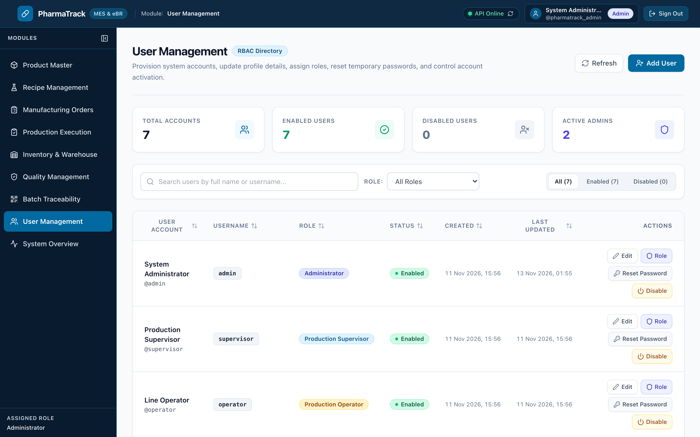

*Figure 11: User Administration console displaying accounts, role assignments, and active states.*

- **Module Purpose:** Manage user identities, assign operational roles, control account activation, and perform administrative password resets.
- **Industry Concept:** Regulatory compliance requires authorized user lists, individual accountability, and prevention of generic shared credentials.
- **Features & Operations:** User account provisioning, role reassignment, account enable/disable toggling, and temporary password reset.
- **Inputs & Outputs:** Inputs: Username, Full Name, Assigned Role, Initial Password. Outputs: User account summary list (intentionally omitting password hashes).
- **Business Rules & Validations:** Usernames must be unique (3–50 characters); passwords must meet security complexity rules; self-disable or self-role-demotion of the sole active administrator is blocked.
- **Role Permissions:** Strictly restricted to `ADMIN`.
- **Frontend Implementation:** `UserManagement.jsx`, `UserTable.jsx`, `UserCreateModal.jsx`, and `UserRoleModal.jsx`.
- **Backend Implementation:** `AdminUserController.java` (`/api/admin/users`) delegates to `AdminUserService.java`.
- **Database Relationships:** Queries and mutates `user_accounts` table.

---

## 5. Role-Based Access Control (RBAC) Matrix

PharmaTrack enforces strict least-privilege access control at both the React navigation/routing layer and Spring Security REST controller layer (`@PreAuthorize` / `SecurityConfig`):

| Module / Action | `ADMIN` | `PRODUCTION_SUPERVISOR` | `OPERATOR` | `QC_ANALYST` | `QA_REVIEWER` |
| :--- | :---: | :---: | :---: | :---: | :---: |
| **Product Master (View / Edit)** | ✅ Full (Author & Edit) | 👁️ View Only | 👁️ View Only | 👁️ View Only | 👁️ View Only |
| **Master Recipes (View / Author / Status)** | ✅ Full | ✅ Author & Edit | ❌ Blocked | 👁️ View Only | 👁️ View & Status Lifecycle |
| **Manufacturing Orders (Schedule / Cancel)** | ✅ Full | ✅ Full | 👁️ View Only | 👁️ View Only | 👁️ View Only |
| **eBR Execution Steps (Start / Complete)** | 👁️ View Only | 👁️ View Only | ✅ Full Execution | ❌ Blocked | 👁️ View Only |
| **Batch Yield Recording** | ✅ Record Yield | ✅ Record Yield | ✅ Record Yield | ❌ Blocked | 👁️ View Only |
| **QC Analytical Checks (Record / Correct)** | ❌ Blocked | ❌ Blocked | ❌ Blocked | ✅ Full (Record & Correct) | 👁️ View Only |
| **QA Batch Disposition (Release / Reject / Hold)** | ❌ Blocked | ❌ Blocked | ❌ Blocked | ❌ Blocked | ✅ Full (Disposition Gate) |
| **Deviations (Log Incident)** | ❌ Blocked (Separation of Duties) | ✅ Log Incident | ✅ Log Incident | ✅ Log Incident | ✅ Log Incident |
| **Deviations (Investigation & Root Cause)** | ❌ Blocked | ✅ Investigate & RCA | ❌ Blocked | ✅ Investigate & RCA | ✅ Investigate & RCA |
| **CAPA Actions (Create & Complete Tasks)** | ❌ Blocked | ✅ Create & Complete | ❌ Blocked | ✅ Complete Tasks | ✅ Create & Complete |
| **Deviations (Formal QA Lifecycle & Closure)** | ❌ Blocked | ❌ Blocked | ❌ Blocked | ❌ Blocked | ✅ Full (Start CAPA, Reopen, Cancel, Close) |
| **Inventory & Warehouse (Receipts / Issues / Adjustments)** | ✅ Full (Receipts & Adjustments) | ✅ Full (Receipts, Issues & Adjustments) | ⚡ Issues Only | 👁️ View Only | ⚡ Adjustments Only |
| **QR Batch Traceability (Scan & Dossier)** | ✅ Full | ✅ Full | ✅ Full | ✅ Full | ✅ Full |
| **Audit Trail Logs (View Full History)** | ✅ Full (System Audit) | ❌ Blocked | ❌ Blocked | ❌ Blocked | ✅ Full (QA Oversight) |
| **User Administration & Role Assignment** | ✅ Full | ❌ Blocked | ❌ Blocked | ❌ Blocked | ❌ Blocked |

---

## 6. System Architecture & Infrastructure

PharmaTrack uses a containerized, decoupled three-tier architecture deployed across production cloud infrastructure:

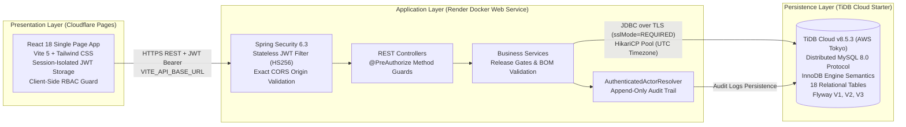

---

## 7. Frontend Architecture & Implementation

### Verified Directory Layout
```text
frontend/
├── package.json               # React 18.3.1, Vite 5.4.11, Tailwind CSS 3.4.15
├── vite.config.js             # Build-time API URL validation and production dead-code elimination
├── tailwind.config.js         # Custom pharma color palette and typography
├── index.html                 # Mount point with accessible HTML structure
└── src/
    ├── App.jsx                # Core router, deep-linking, tab state, and global error boundaries
    ├── main.jsx               # React DOM entry point
    ├── components/            # UI components and feature modals
    │   ├── ui/                # Accessible primitives (DataTable, InlineAlert, StatusBadge)
    │   ├── LoginPage.jsx      # Authentication screen with demo role selectors
    │   ├── ProductManagement.jsx
    │   ├── RecipeManagement.jsx
    │   ├── OrderManagement.jsx
    │   ├── ProductionExecution.jsx
    │   ├── ExecutionWorkspace.jsx
    │   ├── QualityManagement.jsx
    │   ├── DeviationManagement.jsx
    │   ├── DeviationWorkspace.jsx
    │   ├── InventoryManagement.jsx
    │   ├── BatchTraceability.jsx
    │   └── UserManagement.jsx
    ├── context/
    │   └── AuthContext.jsx    # Session restoration, JWT storage, cold-start retry handling
    ├── services/              # Domain REST API modules
    │   ├── apiClient.js       # Centralized fetch wrapper attaching JWT and formatting errors
    │   ├── authApi.js
    │   ├── productApi.js
    │   ├── recipeApi.js
    │   ├── orderApi.js
    │   ├── productionExecutionApi.js
    │   ├── qualityApi.js
    │   ├── deviationApi.js
    │   ├── inventoryApi.js
    │   ├── batchTraceabilityApi.js
    │   └── adminUserApi.js
    └── utils/                 # Pure helper functions
        ├── apiUrlConfig.js    # Strict API URL validation (fails if localhost in prod bundle)
        ├── dateTimeUtils.js   # Asia/Kolkata (+05:30) date/time formatting helpers
        └── rbacUtils.js       # Tab navigation permissions and role predicate functions
```

---

## 8. Backend Architecture & Implementation

### Verified Package Layout
```text
backend/src/main/java/com/pharmatrack/
├── PharmaTrackApplication.java           # Spring Boot entry point
├── config/                               # Startup security guards and bootstrap initializers
│   ├── ProductionConfigurationGuardInitializer.java
│   ├── ProductionEnvironmentPostProcessor.java
│   └── SecurityBootstrapInitializer.java
├── controller/                           # REST API Endpoints
│   ├── AuthController.java               # /api/auth
│   ├── HealthController.java             # /api/health
│   ├── ProductController.java            # /api/products
│   ├── RecipeController.java             # /api/recipes
│   ├── ManufacturingOrderController.java # /api/orders
│   ├── BatchController.java              # /api/batches
│   ├── ProductionExecutionController.java # /api/batches (execution & steps)
│   ├── BatchTraceabilityController.java  # /api/batches (QR & traceability)
│   ├── QualityController.java            # /api/quality (checks & disposition)
│   ├── DeviationController.java          # /api/quality (deviations & capas)
│   ├── InventoryController.java          # /api/inventory
│   └── AdminUserController.java          # /api/admin/users
├── service/                              # Core business logic and validation gates
│   ├── ProductService.java
│   ├── RecipeService.java
│   ├── ManufacturingOrderService.java
│   ├── ProductionExecutionService.java
│   ├── QualityService.java
│   ├── DeviationService.java
│   ├── InventoryService.java
│   ├── BatchTraceabilityService.java
│   └── AdminUserService.java
├── repository/                           # 17 Spring Data JPA repository interfaces
├── entity/                               # 18 JPA domain entities
├── dto/                                  # Validated request and sanitized response DTOs
├── exception/                            # Global exception handling and error sanitization
│   ├── GlobalExceptionHandler.java
│   └── SensitiveDataSanitizer.java
├── security/                             # Spring Security, JWT filter, and actor resolution
│   ├── SecurityConfig.java
│   ├── JwtAuthenticationFilter.java
│   ├── JwtService.java
│   └── AuthenticatedActorResolver.java
└── util/
    └── AppTime.java                      # Canonical Asia/Kolkata (+05:30) time authority
```

### Request Lifecycle
```text
Browser Client
   │ (HTTPS REST + Authorization: Bearer <JWT>)
   ▼
SecurityFilterChain (SecurityConfig)
   │ 1. Validate CORS Origin (CorsOriginSupport)
   │ 2. Extract & Validate JWT Signature/Expiry (JwtAuthenticationFilter)
   │ 3. Check Route & Method RBAC Matchers
   ▼
REST Controller Layer
   │ 1. Parse JSON payload into DTO
   │ 2. Execute Bean Validation (@Valid, @NotNull, @Size)
   ▼
Business Service Layer
   │ 1. Resolve Authenticated Actor Identity (AuthenticatedActorResolver)
   │ 2. Evaluate Domain Rules & Release Gates (@Transactional)
   │ 3. Log Mutation to Audit Trail (audit_logs table)
   ▼
Repository Layer (Spring Data JPA)
   │ Hibernate ORM generates parameterized SQL
   ▼
Distributed Database (TiDB Cloud)
   │ Evaluates unique indexes, foreign keys, and constraints
   ▼
Sanitized JSON Response (ErrorResponse or Domain DTO)
```

---

## 9. Database Design & Flyway Evolution

PharmaTrack's relational schema is version-controlled via Flyway across 3 purely additive migrations, comprising **18 core application tables** and `flyway_schema_history`:

```text
┌────────────────────────────────────────────────────────────────────────────────────────────────────────┐
│                                       FLYWAY SCHEMA EVOLUTION                                         │
├───────────────────────────────────┬───────────────────────────────────┬────────────────────────────────┤
│ Flyway V1: Initial Core Schema    │ Flyway V2: Inventory & Warehouse  │ Flyway V3: QR Traceability     │
│ (13 Tables)                       │ (5 Tables)                        │ (Schema Expansion)             │
├───────────────────────────────────┼───────────────────────────────────┼────────────────────────────────┤
│ 1. users                          │ 14. raw_materials                 │ • Added `qr_code` to `batches` │
│ 2. products                       │ 15. warehouses                    │ • Added unique index           │
│ 3. recipes                        │ 16. storage_locations             │   `uk_batches_qr_code`         │
│ 4. recipe_steps                   │ 17. material_lots                 │ • Backfilled deterministic     │
│ 5. qc_specifications              │ 18. stock_movements               │   codes: `QR-PT-BAT-...`       │
│ 6. manufacturing_orders           │                                   │                                │
│ 7. batches                        │                                   │                                │
│ 8. batch_execution_steps          │                                   │                                │
│ 9. quality_checks                 │                                   │                                │
│ 10. deviations                    │                                   │                                │
│ 11. capa_tasks                    │                                   │                                │
│ 12. deviation_attachments         │                                   │                                │
│ 13. audit_logs                    │                                   │                                │
└───────────────────────────────────┴───────────────────────────────────┴────────────────────────────────┘
```

### Entity Relationship Diagram (ERD)

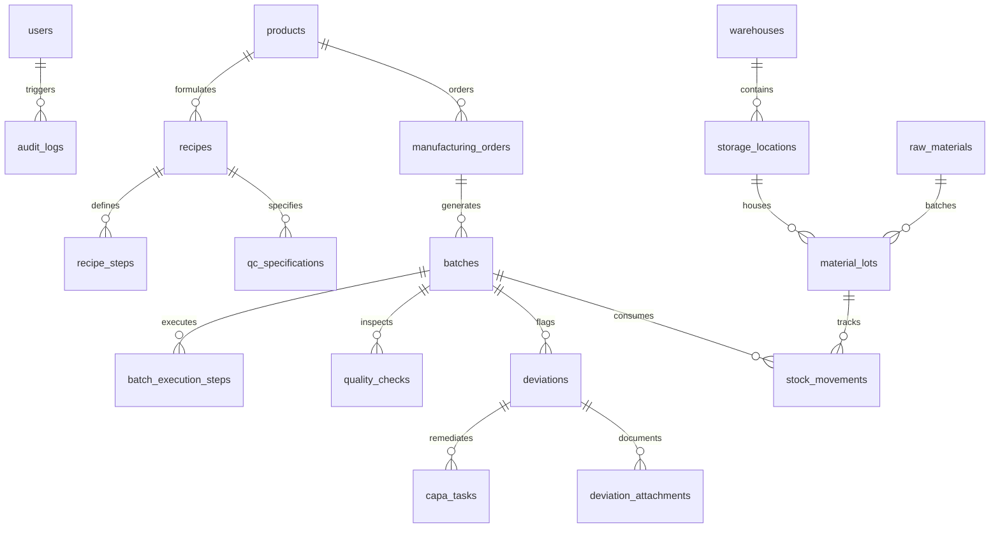

---

## 10. Comprehensive REST API Reference

All endpoints (except `/api/health` and `/api/auth/login`) require an `Authorization: Bearer <token>` header.

### Authentication (`/api/auth`)
| Method | Endpoint | Access | Description |
| :--- | :--- | :--- | :--- |
| `POST` | `/api/auth/login` | Public | Authenticates credentials and returns a signed HS256 JWT. |
| `GET` | `/api/auth/me` | Authenticated | Returns current authenticated user profile and permissions. |

### System Health (`/api/health`)
| Method | Endpoint | Access | Description |
| :--- | :--- | :--- | :--- |
| `GET` | `/api/health` | Public | Evaluates database connectivity and returns `UP` (200) or `DOWN` (503). |

### Product Master (`/api/products`)
| Method | Endpoint | Access | Description |
| :--- | :--- | :--- | :--- |
| `GET` | `/api/products` | All Roles | Lists all registered drug products. |
| `GET` | `/api/products/{id}` | All Roles | Fetches detailed product formulation data. |
| `POST` | `/api/products` | `ADMIN` | Registers a new drug formulation. |
| `PUT` | `/api/products/{id}` | `ADMIN` | Updates an existing product record. |
| `PATCH`| `/api/products/{id}/status` | `ADMIN` | Toggles product active/inactive status. |

### Master Recipes (`/api/recipes`)
| Method | Endpoint | Access | Description |
| :--- | :--- | :--- | :--- |
| `GET` | `/api/recipes` | Non-OPERATOR | Lists all master recipes and revisions. |
| `GET` | `/api/recipes/{id}` | Non-OPERATOR | Returns recipe steps and QC specifications. |
| `POST` | `/api/recipes` | `ADMIN`, `SUPERVISOR` | Authors a new master recipe. |
| `POST` | `/api/recipes/{id}/new-version` | `ADMIN`, `SUPERVISOR` | Clones approved recipe into an incremented draft version. |
| `PATCH`| `/api/recipes/{id}/status` | `ADMIN`, `SUPERVISOR` | Transitions recipe status (`DRAFT` ➔ `APPROVED` ➔ `ARCHIVED`). |

### Manufacturing Orders (`/api/orders`)
| Method | Endpoint | Access | Description |
| :--- | :--- | :--- | :--- |
| `GET` | `/api/orders` | All Roles | Lists scheduled manufacturing orders. |
| `POST` | `/api/orders` | `ADMIN`, `SUPERVISOR` | Creates a new order and schedules production. |
| `PATCH`| `/api/orders/{id}/status` | `ADMIN`, `SUPERVISOR` | Releases or cancels an order. Releasing provisions child batches. |

### Batches & eBR Execution (`/api/batches`)
| Method | Endpoint | Access | Description |
| :--- | :--- | :--- | :--- |
| `GET` | `/api/batches/execution` | All Roles | Lists active shop-floor batches and execution progress. |
| `GET` | `/api/batches/{id}` | All Roles | Returns batch header and current status. |
| `GET` | `/api/batches/{id}/steps` | All Roles | Returns all execution steps for the batch. |
| `POST` | `/api/batches/{id}/steps/initialize` | `OPERATOR` | Instantiates recipe steps into the batch execution ledger. |
| `PATCH`| `/api/batches/{id}/steps/{stepId}/start` | `OPERATOR` | Marks an execution step as `IN_PROGRESS`. |
| `PATCH`| `/api/batches/{id}/steps/{stepId}/complete` | `OPERATOR` | Completes step, validating operational parameters. |
| `PATCH`| `/api/batches/{id}/status` | `OPERATOR`, `SUPERVISOR` | Records final yield and transitions batch to `COMPLETED`. |

### Batch Traceability & QR (`/api/batches`)
| Method | Endpoint | Access | Description |
| :--- | :--- | :--- | :--- |
| `GET` | `/api/batches/{id}/qr` | All Roles | Generates PNG QR code byte stream and base64 payload. |
| `GET` | `/api/batches/qr/{identifier}` | All Roles | Resolves batch by QR code or batch number. |
| `GET` | `/api/batches/{id}/traceability` | All Roles | Returns 8-section complete batch audit dossier. |
| `GET` | `/api/batches/traceability/{identifier}` | All Roles | Direct dossier lookup via QR identifier string. |

### Quality & QA Release (`/api/quality`)
| Method | Endpoint | Access | Description |
| :--- | :--- | :--- | :--- |
| `GET` | `/api/quality/batches` | All Roles | Lists batches awaiting QC testing or QA disposition. |
| `POST` | `/api/quality/batches/{id}/checks` | `QC_ANALYST` | Records an analytical test result with tolerance check. |
| `POST` | `/api/quality/checks/{id}/correct` | `QC_ANALYST` | Logs an audited correction to a test value with justification. |
| `POST` | `/api/quality/batches/{id}/disposition` | `QA_REVIEWER` | Formally releases, rejects, or places batch on hold. |
| `GET` | `/api/quality/audit-logs` | `ADMIN`, `QA_REVIEWER` | Returns the centralized append-only system audit log. |

### Quality Management: Deviations & CAPA (`/api/quality`)
| Method | Endpoint | Access | Description |
| :--- | :--- | :--- | :--- |
| `GET` | `/api/quality/deviations` | All Roles | Lists all logged deviations with optional status, severity, and batch filters. |
| `GET` | `/api/quality/batches/{batchId}/deviations` | All Roles | Retrieves deviations linked to a specific manufacturing batch. |
| `GET` | `/api/quality/batches/{batchId}/linkable-records` | All Roles | Returns authoritative QC checks, eBR steps, and audit events for linking. |
| `GET` | `/api/quality/deviations/{id}` | All Roles | Retrieves full deviation dossier including RCA, CAPA tasks, and audit logs. |
| `POST` | `/api/quality/deviations` | `SUPERVISOR`, `OPERATOR`, `QC_ANALYST`, `QA_REVIEWER` | Reports a new deviation against an active batch (`ADMIN` strictly blocked). |
| `POST` | `/api/quality/deviations/{id}/start-investigation` | `SUPERVISOR`, `QC_ANALYST`, `QA_REVIEWER` | Transitions deviation from `OPEN` to `UNDER_INVESTIGATION`. |
| `POST` | `/api/quality/deviations/{id}/record-root-cause` | `SUPERVISOR`, `QC_ANALYST`, `QA_REVIEWER` | Records 5 Whys analysis and root cause categories. |
| `POST` | `/api/quality/deviations/{id}/start-capa` | `QA_REVIEWER` | Formal QA gate: transitions deviation from RCA to `CAPA_IN_PROGRESS`. |
| `POST` | `/api/quality/deviations/{id}/capas` | `SUPERVISOR`, `QA_REVIEWER` | Creates a new corrective or preventive action item with due date. |
| `POST` | `/api/quality/capas/{id}/start` | `SUPERVISOR`, `QC_ANALYST`, `QA_REVIEWER` | Begins execution on an open CAPA action item. |
| `POST` | `/api/quality/capas/{id}/complete` | `SUPERVISOR`, `QC_ANALYST`, `QA_REVIEWER` | Completes CAPA task with mandatory completion evidence. |
| `POST` | `/api/quality/capas/{id}/cancel` | `QA_REVIEWER` | Cancels a CAPA action with mandatory cancellation justification. |
| `POST` | `/api/quality/deviations/{id}/submit-verification` | `SUPERVISOR`, `QC_ANALYST`, `QA_REVIEWER` | Submits effectiveness review evidence, advancing to `PENDING_VERIFICATION`. |
| `POST` | `/api/quality/deviations/{id}/reopen-capa` | `QA_REVIEWER` | Reopens deviation back to `CAPA_IN_PROGRESS` if verification is insufficient. |
| `POST` | `/api/quality/deviations/{id}/close` | `QA_REVIEWER` | Verifies effectiveness and closes deviation (terminal CLOSED state). |

### Inventory & Warehousing (`/api/inventory`)
| Method | Endpoint | Access | Description |
| :--- | :--- | :--- | :--- |
| `GET` | `/api/inventory/summary` | All Roles | Provides warehouse metrics and stock alerts. |
| `GET` | `/api/inventory/materials` | All Roles | Lists active raw materials and reorder levels. |
| `POST` | `/api/inventory/materials` | `ADMIN`, `SUPERVISOR` | Registers a new raw material item. |
| `GET` | `/api/inventory/lots` | All Roles | Lists material lots with expiry and quarantine status. |
| `POST` | `/api/inventory/receipts` | `ADMIN`, `SUPERVISOR` | Records a goods receipt and creates a new lot. |
| `POST` | `/api/inventory/issues` | `ADMIN`, `SUPERVISOR`, `OPERATOR` | Issues material against a manufacturing order BOM. |
| `POST` | `/api/inventory/adjustments` | `ADMIN`, `SUPERVISOR`, `QA_REVIEWER` | Audits inventory adjustments with mandatory reason. |
| `GET` | `/api/inventory/movements` | All Roles | Returns stock movement history. |

### User Administration (`/api/admin/users`)
| Method | Endpoint | Access | Description |
| :--- | :--- | :--- | :--- |
| `GET` | `/api/admin/users` | `ADMIN` | Lists all user accounts and roles. |
| `POST` | `/api/admin/users` | `ADMIN` | Provisions a new user account with assigned role. |
| `PATCH`| `/api/admin/users/{id}/role` | `ADMIN` | Changes user role and increments token version. |
| `PATCH`| `/api/admin/users/{id}/status` | `ADMIN` | Activates or disables user account access. |
| `PATCH`| `/api/admin/users/{id}/password` | `ADMIN` | Performs an administrative password reset. |

---

## 11. Complete Business Workflows

### 11.1 End-to-End Manufacturing Lifecycle

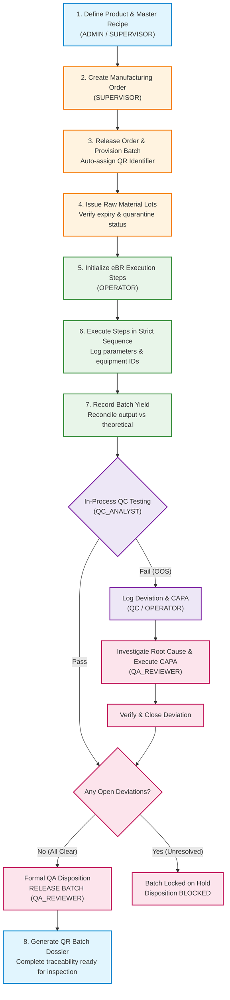

### 11.2 Raw Material Inventory & Issue Lifecycle
```text
Supplier Shipment Arrives
   │
   ▼
1. Goods Receipt (POST /api/inventory/receipts)
   • Creates MaterialLot in QUARANTINED status
   • Appends GOODS_RECEIPT to stock_movements ledger
   │
   ▼
2. Quality Inspection & Release
   • Lot transitioned to ACTIVE status
   │
   ▼
3. Material Issuance to Manufacturing Order (POST /api/inventory/issues)
   • Verifies lot is ACTIVE and not expired
   • Checks requested quantity against Order BOM requirements
   • Atomically decrements lot available_quantity
   • Appends MATERIAL_ISSUE to stock_movements ledger linked to order_id
```

### 11.3 Quality Testing, Deviation & CAPA Lifecycle
```text
Batch Execution Finalized (COMPLETED status)
   │
   ▼
1. In-Process Quality Checks (POST /api/quality/batches/{id}/checks)
   • Analyst records measured numeric values
   • System evaluates against Recipe specification [min_limit, max_limit]
   ├── If within tolerance: Marked PASS
   └── If out of specification: Marked FAIL
        │
        ▼
2. Deviation Logging (POST /api/quality/deviations)
   • Operator or QC logs incident with initial severity rating
   • Batch is automatically locked from QA release
   │
   ▼
3. Investigation & 5 Whys Root Cause Analysis
   • Supervisor or QC records root cause category and findings
   │
   ▼
4. CAPA Task Execution
   • QA approves start of CAPA implementation
   • Corrective and Preventive action tasks assigned and executed
   │
   ▼
5. Effectiveness Verification & QA Closure
   • QA verifies evidence and formally closes deviation
   │
   ▼
6. QA Release Disposition (POST /api/quality/batches/{id}/disposition)
   • Release Gate confirms all required QC tests PASS and 0 open deviations
   • Batch marked APPROVED for commercial packaging and distribution
```

---

## 12. Security Architecture & Implementation

1. **Stateless JWT Authentication (HS256):** Tokens are signed using HMAC-SHA256 with a key of at least 256 bits (`JWT_SECRET`). Tokens expire after a configurable duration (default: 1 hour in production, 24 hours in local development) and are stored in browser `sessionStorage`, isolating sessions between tabs.
2. **Server-Derived Identity Resolution:** The backend extracts user identity directly from signed JWT claims using `AuthenticatedActorResolver`. Client-submitted identity fields are ignored, preventing actor spoofing.
3. **Fail-Closed Startup Verification:** `ProductionConfigurationGuardInitializer` inspects runtime settings on boot. Startup aborts immediately if:
   - `JWT_SECRET` is missing, shorter than 256 bits, or matches known placeholder patterns.
   - `CORS_ALLOWED_ORIGINS` contains wildcards (`*`) or malformed URL patterns.
   - Database connection lacks TLS (`sslMode=DISABLED`).
4. **BCrypt Password Hashing:** User passwords are encrypted using BCrypt with a default work factor of 10. Passwords and hashes are strictly excluded from response DTOs and logs.
5. **Role Versioning & Revocation:** Role reassignments increment the user's `token_version`, instantly invalidating tokens issued under previous privileges.

---

## 13. Validation & Error Handling Strategy

1. **Declarative Bean Validation:** Request DTOs enforce constraints using `@NotNull`, `@NotBlank`, `@Size`, `@Min`, `@Max`, and `@DecimalMin`.
2. **Sanitized Error Responses:** `GlobalExceptionHandler` intercepts exceptions and returns consistent JSON `ErrorResponse` payloads:
   ```json
   {
     "status": 400,
     "error": "Bad Request",
     "message": "Step temperature 85.0°C exceeds maximum specification limit of 75.0°C",
     "timestamp": "2026-11-13T01:30:00.123456+05:30"
   }
   ```
3. **Sensitive Data Sanitizer:** `SensitiveDataSanitizer` scans error messages and removes database URLs, SQL query strings, hostnames, and stack traces before delivery to clients.
4. **Timezone Authority:** All timestamps are standardized using `AppTime.java` in canonical `Asia/Kolkata` (`+05:30`) while stored in UTC in the relational database.

---

## 14. Testing Strategy & Quality Assurance

PharmaTrack maintains a comprehensive multi-layered automated test suite totaling **808 automated tests**:

### Backend Testing (JUnit 5 + Spring Security Test + MockMvc)
- **684 Individual Tests across 57 Test Suites:** 100% pass rate executed against isolated in-memory H2 database (0 failures, 0 errors, 0 skipped).
- **Core Verification Suites:**
  - `BusinessRbacAuthorizationIntegrationTest`: Exhaustively verifies every HTTP method and role combination across all endpoints.
  - `QaReleaseGateHttpIntegrationTest`: Validates that missing QC checks or unresolved deviations block batch release.
  - `InventoryServiceAndConcurrencyTest`: Verifies atomic stock deductions and concurrency locking.
  - `TrustedAuditAttributionIntegrationTest`: Verifies that audit records correctly capture authenticated actors during transaction rollbacks.
  - `ProductionProfileConfigurationTest`: Verifies fail-closed startup behavior under production profile.

### Frontend Testing (Node.js Native Test Runner)
- **124 Individual Tests:** 100% pass rate (`node --test`).
- **Core Verification Areas:**
  - Route and tab access guards matching the backend RBAC matrix.
  - Formulation and recipe step form validations.
  - Date and time formatting in `Asia/Kolkata` across DST boundaries.
  - Batch traceability dossier rendering and QR modal behavior.

### Test Execution Commands
```bash
# Run backend test suite (684 tests across 57 suites)
cd backend && ./mvnw test

# Run frontend test suite (124 tests)
cd frontend && npm test
```

---

## 15. Technical Decisions & Architectural Trade-offs

### 1. Decoupled React SPA & Containerized Spring Boot
- **Decision:** Separate React frontend hosted on Cloudflare Pages from a containerized Spring Boot backend hosted on Render.
- **Problem Solved:** Enables independent scaling, edge-cached static asset delivery, and distinct deployment lifecycles.
- **Trade-offs:** Introduces CORS overhead and requires cross-origin JWT bearer authentication.
- **Alternatives Considered:** Monolithic Spring Boot with Thymeleaf; rejected due to limited interactivity for complex shop-floor execution workspaces.

### 2. Distributed Relational Database (TiDB Cloud)
- **Decision:** Utilize TiDB Cloud Serverless (MySQL 8.0 wire protocol) instead of NoSQL or managed PostgreSQL.
- **Problem Solved:** Provides distributed high-availability and horizontal scalability while maintaining strict ACID transactional guarantees, foreign key constraints, and relational integrity.
- **Trade-offs:** TiDB differs slightly from MySQL on table auto-increment allocation; resolved via explicit sequence synchronization in Flyway migrations.

### 3. Flyway Version-Controlled Migrations
- **Decision:** Use Flyway migrations (`V1`, `V2`, `V3`) with Hibernate `ddl-auto=validate`.
- **Problem Solved:** Eliminates schema drift between local, staging, and production environments; guarantees reproducible deployments.
- **Trade-offs:** Schema modifications require formal migration scripts; rolling back requires explicit reversal scripts.

### 4. Tab-Isolated Session Storage for JWTs
- **Decision:** Store JWTs in browser `sessionStorage` rather than `localStorage` or `HttpOnly` cookies.
- **Problem Solved:** Allows operators to run different roles (e.g., Operator in Tab 1, QC Analyst in Tab 2) simultaneously for testing and multi-station plant workflows without authorization collisions.
- **Trade-offs:** Tokens do not persist across browser restarts (operators must log in again upon opening a new window).

---

## 16. Technology Stack Reference

| Layer | Component | Version / Runtime | Notes |
| :--- | :--- | :--- | :--- |
| **Backend Runtime** | Java | 17 LTS (Eclipse Temurin) | Jammy Linux base |
| **Backend Framework** | Spring Boot | 3.3.5 | Spring Security, Spring Data JPA, Web |
| **Database Engine** | TiDB Cloud | v8.5.3 (AWS Tokyo) | MySQL 8.0 Protocol & InnoDB Semantics |
| **Schema Migrations** | Flyway | 10.10 | 18 Relational Tables across 3 migrations |
| **Security & Auth** | JJWT | 0.12.6 | Stateless HS256 (256-bit secret) |
| **Frontend Framework**| React | 18.3.1 | ES6+ JavaScript |
| **Build Tool** | Vite | 5.4.11 | Dead-code production elimination |
| **Styling** | Tailwind CSS | 3.4.15 | Custom pharma UI palette |
| **Icons & QR** | Lucide / ZXing | Lucide 0.460.0 / ZXing 3.5.3 | High-res QR code generation & scanning |
| **Testing** | JUnit 5 / Node Runner | JUnit 5.10 / Node 20.x | 684 backend + 124 frontend = 808 tests |
| **Hosting** | Cloudflare / Render | Edge Pages / Docker | Zero-cost free cloud hosting architecture |

---

## 17. Local Development & Setup Guide

### Prerequisites
- **Java Development Kit (JDK):** Version 17 or higher
- **Node.js & npm:** Node 18+ (tested on Node 20.x) and npm 9+
- **Relational Database:** MySQL 8.0+ or TiDB instance running locally or via cloud endpoint

### 1. Clone Repository
```bash
git clone https://github.com/nimishaWargantiwar/Pharma-Track.git
cd Pharma-Track
```

### 2. Configure Backend Secrets
Create `backend/config/application-local.properties` (this file is gitignored):
```properties
# Local Database Configuration
spring.datasource.url=jdbc:mysql://localhost:3306/pharmatrack_db?createDatabaseIfNotExist=true&useSSL=false&serverTimezone=UTC
spring.datasource.username=your_local_db_user
spring.datasource.password=your_local_db_password

# JWT Signing Secret (Generate via: openssl rand -base64 32)
app.jwt.secret=base64:YOUR_GENERATED_BASE64_SECRET_KEY_HERE
app.jwt.expiration-ms=86400000

# Bootstrap Initial Administrator
app.security.bootstrap.admin-username=admin
app.security.bootstrap.admin-password=YourStrongAdminPassword123!

# Enable Local Demo Accounts (admin, supervisor, operator, qc_analyst, qa_reviewer)
app.security.local-demo.enabled=true
app.security.local-demo.password=YourDemoPassword123!
```

### 3. Run Backend
```bash
cd backend

# Execute complete backend test suite (runs against in-memory H2)
./mvnw test

# Start the Spring Boot backend on http://localhost:8080
./mvnw spring-boot:run
```

Verify backend health:
```bash
curl http://localhost:8080/api/health
```

### 4. Configure & Run Frontend
In a new terminal:
```bash
cd frontend

# Install dependencies
npm install

# Run frontend test suite (124 tests)
npm test

# Start Vite dev server on http://localhost:5173
npm run dev
```

Open `http://localhost:5173` in your browser.

---

## 18. Production Deployment Guide

### Cloudflare Pages Configuration (Frontend)
- **Framework Preset:** Vite
- **Root Directory:** `frontend`
- **Build Command:** `npm run build`
- **Output Directory:** `dist`
- **Environment Variable:**
  ```env
  VITE_API_BASE_URL=https://pharmatrack-backend-92pf.onrender.com/api
  ```

### Render Web Service Configuration (Backend)
- **Runtime:** Docker (uses `backend/Dockerfile`)
- **Root Directory:** `backend`
- **Health Check Path:** `/api/health`
- **Environment Variables:**
  ```env
  SPRING_PROFILES_ACTIVE=prod
  DB_URL=jdbc:mysql://gateway01.ap-northeast-1.prod.aws.tidbcloud.com:4000/pharmatrack_prod?sslMode=REQUIRED&serverTimezone=UTC
  DB_USERNAME=your_tidb_username.root
  DB_PASSWORD=[REDACTED]
  JWT_SECRET=base64:[REDACTED_256_BIT_SECRET]
  CORS_ALLOWED_ORIGINS=https://pharma-track.pages.dev
  BOOTSTRAP_ADMIN_ENABLED=true
  BOOTSTRAP_ADMIN_USERNAME=admin
  BOOTSTRAP_ADMIN_PASSWORD=[REDACTED_STRONG_ADMIN_PASSWORD]
  ```

---

## 19. Future Roadmap

- [ ] **Electronic Signature Re-authentication:** A re-authentication prompt requiring users to re-enter credentials along with a formal signature reason when executing critical batch transitions.
- [ ] **OPC-UA / SCADA Machine Telemetry:** Direct IoT ingestion of bioreactor temperatures, mixer RPMs, and scale readings into eBR steps without manual data entry.
- [ ] **Automated Cold-Chain Telemetry:** Continuous temperature tracking for refrigerated storage locations with automated deviation generation upon threshold excursion.
- [ ] **Watermarked PDF Batch Record Dossier:** Automated generation of formal PDF batch dossiers for regulatory submission and archiving.

---

## 20. Known Limitations

- **Educational & Portfolio Scope:** PharmaTrack is an engineering portfolio project; it is not formally qualified for commercial drug manufacturing.
- **Render Free-Tier Spin Down:** On the free tier, the backend container spins down after 15 minutes of inactivity, requiring approximately 30–50 seconds to wake up upon receiving a new request.
- **Browser-Dependent Barcode Scanning:** Live camera QR scanning depends on browser support for the `BarcodeDetector` API (supported in Chromium-based browsers; fallback manual text entry is provided for Safari/Firefox).

---

## 21. Project Showcase & Contact

- **Author:** Nimisha Wargantiwar
- **GitHub:** [@nimishaWargantiwar](https://github.com/nimishaWargantiwar)
- **Project Repository:** [https://github.com/nimishaWargantiwar/Pharma-Track](https://github.com/nimishaWargantiwar/Pharma-Track)
- **Live Showcase Application:** [https://pharma-track.pages.dev](https://pharma-track.pages.dev)
- **Backend Health Probe:** [https://pharmatrack-backend-92pf.onrender.com/api/health](https://pharmatrack-backend-92pf.onrender.com/api/health)
